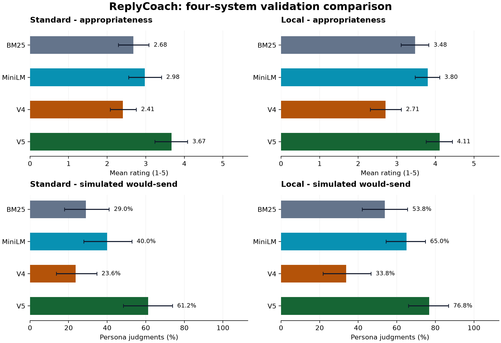
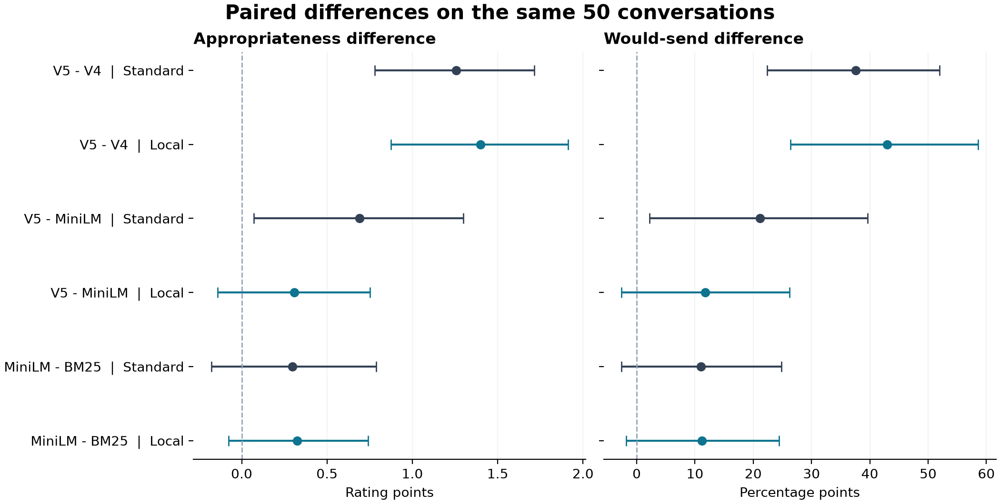

# ReplyCoach: detailed model comparison

Completed validation evaluation | 26 October 2026 | Role E analysis

**27 October follow-up:** local V5 inference reproduced all six saved reply texts
in a fixed three-conversation subset, and the live demo completed all four
sources. The experimental shared-selector replay scored below choosing V5 alone;
it remains experimental. See [V5 verification](../../roles/D_transformer/LOCAL_VERIFICATION.md)
and [the ranking work log](../all_models_ranking_worklog.md). The original
4,000-rating comparison and figures below are unchanged.

## 1. Main findings

**Yes: V4 is the RNN generator with attention; V5 is the Transformer generator.**
The delivered V5 is specifically **mT5-base with a LoRA adapter**, not mT5-small.
Both generate a reply token by token. BM25 and MiniLM instead select a saved
reply from the training bank; MiniLM uses a Transformer encoder to find semantic
similarity, but is a retriever in this project.

V4 and V5 are alternative generators, not layers stacked on top of one another.
Both use an encoder-decoder design; that design is not exclusive to Transformers.

All 4,000 anonymous AI judgments completed successfully: 50 validation conversations,
four systems, two styles and ten fictional personas. Each system/style has 500
ratings, covering the same 50 conversations. There were zero final error records.

**V5 is the leading generator candidate from this comparison.** Its average
appropriateness is 3.666/5 for Standard and 4.110/5 for Local, versus V4's 2.408
and 2.710. The paired differences favour V5 in both styles. V5 also has the
highest observed averages among all four systems, although its Local advantage
over MiniLM is uncertain at this sample size. MiniLM has higher means than BM25,
but their appropriateness difference is not clearly resolved by the intervals.

This supports prioritising V5 for integration and further validation. It does not
establish a universally superior architecture, a reliable real-world chatbot, or
human approval. The evaluator is one Gemma model simulating ten personas.

## 2. What the models actually do

| System | Role in ReplyCoach | How it produces the displayed reply |
| --- | --- | --- |
| BM25 | Lexical retrieval baseline | Matches words against 190 training examples, then returns a stored reply. |
| MiniLM | Semantic retrieval baseline | Uses all-MiniLM-L6-v2 embeddings to retrieve examples, then returns a stored reply. |
| V4 | RNN encoder-decoder generator | An LSTM encoder and an LSTM decoder with Luong attention generate new token sequences. |
| V5 | Transformer encoder-decoder generator | A task-adapted mT5-base model plus LoRA generates new token sequences. |

### V4: LSTM with attention

V4 is an encoder-decoder RNN, with 64-dimensional trainable word embeddings,
128-unit LSTMs and Luong dot-product attention. Attention lets the decoder use
different encoded source positions while producing each output word. The received
checkpoint contains 1,581,059 parameter values, independently counted from its
state dictionary. Its vocabulary and configuration are embedded in the checkpoint.

Role C reused existing DailyDialog-trained weights, then task-fine-tuned on 190
reviewed team items, producing 380 Standard/Local training pairs. The latest
handoff did not repeat the full historical public pretraining. It selected task
epoch 8 using the 50-item validation set. One shared checkpoint uses explicit
style tokens; there is not a separate model for each style.

Inference is bounded greedy decoding, with a 64-token source limit and 40-token
target limit. The current system applies the shared reranker and safety fallback
after generation. All 100 V4 validation generations and the three-mode system
export were previously reproduced on the receiver's machine.

### V5: mT5-base with LoRA

V5 uses a pretrained multilingual Transformer encoder-decoder. The received base
contains 582,401,280 parameter values, with another 1,769,472 in its LoRA adapter:
584,170,752 in the delivered base-plus-adapter package. These counts match the
local weight headers and D's model card. The package has about 369 times V4's
parameter count; this is not an inference-speed measurement.

D's model card reports three training stages:

1. Span corruption on CoSEM and NUS SMS text to adapt language patterns.
2. Full model adaptation on DailyDialog and CoSEM reply pairs.
3. A shared rank-16 LoRA adapter on the 190 team training items, with additional
   context pairs and an unlikelihood penalty to discourage copied inputs.

The base was updated in the earlier stages, then frozen for LoRA training.
The adapter targets attention q/v projections, with alpha 32 and dropout 0.1;
about 0.30% of the delivered parameters are trained during that last stage.
One adapter handles both styles through explicit Standard/Local input tags.

The model card reports a best task loss of 2.494 at epoch 5, source length 128,
target length 48, four-beam decoding and repeated-3-gram blocking. Training was
reported on an RTX 3090 at the university cluster. These training histories are
teammate-reported; this report did not repeat them. V5 inference code and model
cards are now on main, and base/adapter files are present locally. A subsequent
local check reproduced six saved reply texts; see the follow-up above. The judged V5 replies
are the supplied saved export, not a new generation run.

### Why this is a pipeline comparison

V4 and V5 differ in capacity, pretrained knowledge, public adaptation data,
tokenisation, input format, source limits, optimisation and decoding, as well as
architecture. The measured result compares these delivered systems. It does not
isolate the causal benefit of Transformer attention or LoRA alone. V4 and V5 token
losses also use different tokenisers/objectives and must not be compared as if
4.162 versus 2.494 were a common quality scale.

## 3. Evaluation design and interpretation

The human-reviewed project split is 190 training/reply-bank items, 50 validation
queries and 60 locked test items. Only the training and validation files are used
here. The analysis did not read the locked test examples. Current input hashes
match the recorded run inputs, and the completed CSV means were independently
recomputed from every saved persona rating.

All four exports use M2 memory. M2 keeps the newest two turns and can select up
to two relevant older turns from the last eight. These validation histories are
short: 46 have two prior turns, three have three, and one has one. This is not a
long-conversation benchmark or a memory ablation.

The judge sees the original speaker-labelled history, incoming peer message,
requested style and one anonymous reply. Model names, retrieval scores,
checkpoint metadata, authored references and reviewer names are hidden.
Every call uses a fresh judging context. Public packet fields are checked against
the current validation records; private mappings are used only for analysis.

These are the displayed system replies after the shared reranker and fallback
policy, rather than an evaluation of raw retrieval similarity or token likelihood.
V6 in a saved candidate's source field denotes that reranker; the original
retriever or generator is retained in candidate_source metadata. The common
reranker combines 0.6 times the input score with 0.4 times token overlap. Its
scores are not calibrated probabilities of reply correctness.

The judge was local gemma4:12b, with unchanged rubric, ten existing personas,
temperature 0, seed 425, thinking off, context 4096 and output budget 2048.
The model digest and script/rubric/persona configuration are pinned in run.json.
A separate five-conversation, one-persona diagnostic is not pooled into the main
4,000 judgments. Sampling/shuffling used seed 426.

| Measure | Meaning | Important limit |
| --- | --- | --- |
| Appropriateness (1-5) | Does the reply handle the incoming message sensibly in context? | A judge assessment, not verified factual correctness. |
| Naturalness (1-5) | Does the text sound like plausible casual messaging? | Fluent wording can still answer the wrong question. |
| Style fit (1-5) | Does it match the requested Standard or restrained Local style? | This judge gives nearly all replies the maximum score. |
| Would-send (%) | Percentage of simulated persona judgments willing to send with little editing. | Not accuracy, task completion or actual human willingness. |

For each conversation/system/style, first average the ten persona ratings;
then average across the 50 conversations. The same procedure applies to the
would-send indicator. Therefore, 500 ratings per row do not mean 500 independent
conversation samples. Ten personas share a single base judge model.

Uncertainty intervals use 20,000 paired percentile bootstrap resamples of the
50 conversations, seed 425. Each resampled conversation retains every system,
style and persona rating. Intervals are descriptive and conditional on this
dataset, frozen outputs and judge; they do not account for systematic judge bias,
training-seed variance or new domains. Multiple intervals are reported without
family-wise adjustment. No formal corrected significance claim is made.

## 4. Main quality results

| System | Style | Appropriate /5 | Natural /5 | Style /5 | Would-send | Ratings |
| --- | --- | --- | --- | --- | --- | --- |
| BM25 | Standard | 2.678 | 4.862 | 5.000 | 29.0% | 500/500 |
| BM25 | Local | 3.476 | 4.658 | 4.862 | 53.8% | 500/500 |
| MiniLM | Standard | 2.976 | 4.896 | 5.000 | 40.0% | 500/500 |
| MiniLM | Local | 3.802 | 4.846 | 4.954 | 65.0% | 500/500 |
| V4 | Standard | 2.408 | 4.582 | 5.000 | 23.6% | 500/500 |
| V4 | Local | 2.710 | 4.700 | 4.920 | 33.8% | 500/500 |
| V5 | Standard | 3.666 | 4.964 | 5.000 | 61.2% | 500/500 |
| V5 | Local | 4.110 | 4.956 | 4.998 | 76.8% | 500/500 |



Figure 1. Means and descriptive 95% conversation-bootstrap intervals. The
would-send panel is simulated willingness, not human approval.

V5 has the highest observed means for appropriateness and naturalness in both
styles. V4 is lowest on appropriateness and simulated would-send. Naturalness is
high across most systems, showing why surface fluency alone is a weak selection
criterion. Standard style fit is exactly 5.000 for every model; it does not
separate them. Local style differences are also small relative to the ceiling.

All four systems have higher Local than Standard appropriateness means. This
does not prove that Local English is inherently better: the reply contents differ,
and the judge can interpret short local phrasing generously. Compare models within
the same requested style rather than crediting the style label itself.

## 5. Paired comparisons on the same conversations

| Comparison | Style | Appropriateness delta [95% interval] | Would-send delta, pp [95% interval] | Wins / ties / losses |
| --- | --- | --- | --- | --- |
| V5 - V4 | Standard | +1.26 [+0.78, +1.72] | +37.6 [+22.4, +52.0] | 36 / 6 / 8 |
| V5 - V4 | Local | +1.40 [+0.88, +1.91] | +43.0 [+26.4, +58.6] | 34 / 2 / 14 |
| V5 - MiniLM | Standard | +0.69 [+0.07, +1.30] | +21.2 [+2.2, +39.6] | 25 / 7 / 18 |
| V5 - MiniLM | Local | +0.31 [-0.14, +0.75] | +11.8 [-2.6, +26.2] | 25 / 8 / 17 |
| MiniLM - BM25 | Standard | +0.30 [-0.18, +0.79] | +11.0 [-2.6, +24.8] | 20 / 17 / 13 |
| MiniLM - BM25 | Local | +0.33 [-0.08, +0.74] | +11.2 [-1.8, +24.4] | 25 / 8 / 17 |



Figure 2. Positive values favour the first named system. Error bars are the same
descriptive 95% paired bootstrap intervals. Wins/ties/losses count conversations
by mean appropriateness, not individual persona votes; each row totals 50.

- **V5 versus V4:** the appropriateness advantage is +1.258 Standard and +1.400
  Local. Both intervals remain above zero, supporting the generator choice within
  this evaluation. V5 wins 36 Standard and 34 Local conversations; it still loses
  eight and fourteen respectively, so the advantage is not universal.
- **V5 versus MiniLM:** the Standard mean advantage is +0.690, with a marginal
  interval above zero. Local is +0.308 with an interval crossing zero. MiniLM
  outperforms V5 on 18 Standard and 17 Local conversations. A claim that generation
  always beats retrieval would be wrong.
- **MiniLM versus BM25:** the observed mean gains are +0.298 Standard and +0.326
  Local, but both appropriateness intervals cross zero. The point estimates favour
  MiniLM; this sample does not clearly resolve that quality advantage.

## 6. Fallbacks, repetition and style differentiation

The primary V4 scores are **system outputs**, not 100 unfiltered RNN replies.
There are 72 selected model generations and 28 safety fallbacks: 12 Standard and
16 Local. BM25, MiniLM and V5 have no selected fallbacks in this export. Excluding
fallbacks only for V4 would change the evaluated question set and distort the
main comparison, so all 100 V4 outputs are retained.

| V4 subset | Style | Replies | Appropriateness /5 | Would-send |
| --- | --- | --- | --- | --- |
| Selected RNN generation | Standard | 38 | 2.237 | 22.6% |
| Fallback | Standard | 12 | 2.950 | 26.7% |
| Selected RNN generation | Local | 34 | 2.359 | 27.9% |
| Fallback | Local | 16 | 3.456 | 46.2% |

These conditional subsets contain different conversations, so their score
difference is not a controlled estimate of fallback effectiveness. It does show
that V4's overall score is not being depressed solely by safety fallbacks; the
selected RNN generations also score poorly.

| System | Unique Standard replies /50 | Unique Local replies /50 | Same text in both styles /50 |
| --- | --- | --- | --- |
| BM25 | 41 | 41 | 0 |
| MiniLM | 37 | 35 | 0 |
| V4 | 32 | 23 | 13 |
| V5 | 50 | 47 | 4 |

Uniqueness normalises case and whitespace only; punctuation is retained.
Same-style-pair counting ignores case and surrounding whitespace. V4's dominant
Standard and Local replies are the two time/place fallback templates, occurring
12 and 16 times. It also repeatedly generates arrival/meeting phrases. V5 has
more varied text, but uniqueness is not a quality score: an incorrect invented
answer can be unique. Four V5 style pairs are identical apart from case; this
can be acceptable when forced slang would be unnatural.

## 7. Where each system struggles

The following breakdowns join the **original validation query's** scenario
and incoming intent, not the retrieved training example's tags. Each value
averages both styles and all personas within each conversation, then averages
the conversations in that subgroup. Only nine scenario labels and nine intent
labels occur in these 50 examples. Counts are small; treat the rows as error-analysis
pointers rather than reliable domain leaderboards. Annotation mistakes can also
affect these groupings.

### By scenario

| Scenario | Conversations | BM25 | MiniLM | V4 | V5 |
| --- | --- | --- | --- | --- | --- |
| assignments and group projects | 6 | 3.28 | 3.78 | 1.36 | 4.32 |
| campus services and equipment | 4 | 3.64 | 3.76 | 2.17 | 3.95 |
| classes and tutorials | 6 | 2.94 | 2.37 | 1.94 | 3.62 |
| course materials | 5 | 2.45 | 3.66 | 2.61 | 4.25 |
| meals and food | 7 | 2.66 | 2.99 | 2.22 | 3.01 |
| meetups and transport | 5 | 3.76 | 4.09 | 3.12 | 4.65 |
| social events and outings | 6 | 2.64 | 3.38 | 3.83 | 3.77 |
| sports and exercise | 5 | 3.43 | 3.63 | 3.08 | 3.75 |
| study sessions and spaces | 6 | 3.21 | 3.24 | 2.81 | 4.02 |

### By incoming intent

| Incoming intent | Conversations | BM25 | MiniLM | V4 | V5 |
| --- | --- | --- | --- | --- | --- |
| apologise or explain | 5 | 3.67 | 3.72 | 2.49 | 3.85 |
| change or reschedule | 5 | 2.97 | 4.16 | 3.06 | 4.53 |
| confirm plan | 5 | 3.32 | 3.29 | 2.23 | 4.06 |
| decline | 5 | 2.89 | 2.85 | 2.49 | 2.78 |
| inform or update | 7 | 3.22 | 3.40 | 2.93 | 4.19 |
| invite or propose | 6 | 2.44 | 2.87 | 3.03 | 3.73 |
| remind or nudge | 4 | 2.45 | 3.05 | 1.88 | 4.22 |
| request help or resource | 6 | 3.84 | 4.09 | 2.04 | 3.47 |
| request information or status | 7 | 2.79 | 3.09 | 2.60 | 4.13 |

V5's strongest observed topic mean is meetups/transport (4.65, n=5), and it
also handles assignments/projects well (4.32, n=6). Its weakest topic mean is
meals/food (3.01, n=7). MiniLM leads V5 on help/resource requests (4.09 versus
3.47, n=6), while V4 is particularly weak on assignments/projects (1.36, n=6).
V4's small advantage in social events is descriptive and includes generic
meeting fallbacks; it does not overturn the full comparison.

## 8. Ten qualitative comparisons

These cases were chosen to explain observed successes, failures and evaluator
limitations; they are not a random error-rate sample. They include four cases
from the earlier five-conversation diagnostic and six additional validation
cases. All replies below are exact saved output text. Appropriateness and
would-send average the ten main-run persona ratings. The comments are assistant
analysis, not independent human annotations or new training labels.

### Case 1: Correctly answering a proposed make-up class (ITEM-E-025, Local)

**Peer:** hi class, I had a family emergency and there will not be any class tomorrow.

**You:** oh no! what about the in class quiz?

**Incoming peer message:** will everyone be free on thursday instead for a make up class instead? paiseh

| System | Exact reply | Appropriate /5 | Would-send |
| --- | --- | --- | --- |
| BM25 | You always late haha, I will chope seat for you | 1.9 | 0% |
| MiniLM | ya, tuesday no class | 2.0 | 0% |
| V4 | okay i will be there soon | 1.1 | 0% |
| V5 | okay, thursday is fine. | 5.0 | 100% |

**Interpretation:** V5 directly confirms Thursday. The retrievers answer an unrelated lateness or Tuesday question, and V4 emits a generic arrival phrase. This is a clear example of useful task-specific generation.

### Case 2: Accepting a running invitation; a fallback can also work (ITEM-B-050, Local)

**Peer:** I haven't exercised in a while

**You:** same, I've been busy with classes

**Incoming peer message:** want to go run later?

| System | Exact reply | Appropriate /5 | Would-send |
| --- | --- | --- | --- |
| BM25 | can, lets find somewhere quiet in the library later | 1.0 | 0% |
| MiniLM | ok i need to run and exercise abit | 3.6 | 50% |
| V4 (fallback) | Okay, want to confirm the time and place? | 5.0 | 100% |
| V5 | Can, I'm going to run later. | 4.7 | 100% |

**Interpretation:** V5 accepts the activity. The V4 reply is a fallback, not an RNN-generated success; its request for logistics happens to fit an invitation. The BM25 library reply is the wrong activity. High fallback scores should not be credited to learned RNN reasoning.

### Case 3: A fluent Transformer reply invents the wrong day (ITEM-C-023, Standard)

**Peer:** saturday im quite free

**You:** same, no plans yet

**Incoming peer message:** want me to jio you for the night market thing?

| System | Exact reply | Appropriate /5 | Would-send |
| --- | --- | --- | --- |
| BM25 | Sorry, do you want to come and play with us | 1.0 | 0% |
| MiniLM | Sure! What time should we meet? | 5.0 | 100% |
| V4 | sure i'll meet you at the entrance | 3.9 | 90% |
| V5 | Sure, I'll be free on Friday. | 1.0 | 0% |

**Interpretation:** The conversation establishes Saturday availability; V5 introduces Friday. MiniLM gives a useful acceptance and follow-up. The V5 Local version also reverses who is inviting whom and scores 2.2/5, showing that the overall leader can fail both styles on one conversation.

### Case 4: V5 confuses the peer with the user (ITEM-A-038, Standard)

**Peer:** are we still playing badminton tonight?

**You:** yeah, I think so

**Incoming peer message:** i might be ten mins late leh

| System | Exact reply | Appropriate /5 | Would-send |
| --- | --- | --- | --- |
| BM25 | Yes, we will be playing badminton later. | 2.0 | 0% |
| MiniLM | Yes, we will be playing badminton later. | 2.0 | 0% |
| V4 | sure let's go back together | 2.0 | 0% |
| V5 | Okay, I'm going to be a little late. | 1.7 | 0% |

**Interpretation:** The peer reports that they might be late. V5 makes the user claim lateness instead. Its Local counterpart, "okay, let me know when you reach", scores 5.0/5 and is much more suitable. One shared adapter does not guarantee semantic consistency between separately generated styles.

### Case 5: Retrieval beats both generators on a concrete help request (ITEM-C-038, Standard)

**Peer:** ive finished drafting the conclusion

**You:** great

**Incoming peer message:** can help me check if this part sounds too long?

| System | Exact reply | Appropriate /5 | Would-send |
| --- | --- | --- | --- |
| BM25 | Hold on, I will check for you | 5.0 | 100% |
| MiniLM | Sure, I'll take a look when I'm done with mine. | 5.0 | 100% |
| V4 | sure i'll meet you there | 1.0 | 0% |
| V5 | Sure, it doesn't cost too much. | 1.0 | 0% |

**Interpretation:** The peer asks for feedback on text length. BM25 and MiniLM offer to check. V4 talks about meeting, and V5 answers a cost question. V5 Local says "okay, maybe a few minutes" and receives 4.7/5: this is at best an implicit offer to check, illustrating generous judgments of ambiguous short replies.

### Case 6: A printer example exposes both model and judge errors (ITEM-A-024, Local)

**Peer:** Hey have you printed the worksheet given out yesterday?

**You:** No, I will need to print it in school. Do you know how to use the printer?

**Incoming peer message:** paiseh, i don't know how to use the printer in school.

| System | Exact reply | Appropriate /5 | Would-send |
| --- | --- | --- | --- |
| BM25 | Can try the second floor one. | 4.4 | 100% |
| MiniLM | Eh, can help me print also? | 4.4 | 90% |
| V4 (fallback) | Okay, want to confirm the time and place? | 2.3 | 0% |
| V5 | Okay, thanks for reminding me. | 1.5 | 0% |

**Interpretation:** The peer admits not knowing how to use the printer. V5 treats this as a reminder. BM25 merely suggests a different floor; MiniLM asks the same uninformed peer to print for the user. Their high Local ratings do not establish that either addresses the problem. MiniLM Standard, a closely related print-for-me request, receives only 1.1/5, illustrating inconsistent interpretation across styles.

### Case 7: Booking change: good V5 response, generous judgment of BM25 (ITEM-A-030, Local)

**Peer:** How long is our booking?

**You:** Oh no, our timer went off.

**Incoming peer message:** sian, need book somewhere else, our booking ran out

| System | Exact reply | Appropriate /5 | Would-send |
| --- | --- | --- | --- |
| BM25 | ok, need email prof? | 3.9 | 90% |
| MiniLM | Eh i think need reserve one, wait ah I check | 5.0 | 90% |
| V4 (fallback) | Okay, want to confirm the time and place? | 5.0 | 100% |
| V5 | okay, we can book somewhere else | 4.9 | 100% |

**Interpretation:** V5 agrees to the actual next step, booking elsewhere. The generic V4 fallback also fits tolerably. BM25 proposes emailing a professor with no grounding in the conversation; the main judge still gives 3.9/5 and 90% simulated willingness. This repeats the concern found before the main run.

### Case 8: A plausible opening-hours answer is not verified factual knowledge (ITEM-A-033, Local)

**Peer:** Hey should we grab lunch?

**You:** sure! Lets head to Koufu

**Incoming peer message:** eh the chicken rice stall open today anot?

| System | Exact reply | Appropriate /5 | Would-send |
| --- | --- | --- | --- |
| BM25 | neh mind, damm long day today | 2.0 | 0% |
| MiniLM | Paiseh, today cannot. Need finish some work. | 4.0 | 70% |
| V4 (fallback) | Okay, want to confirm the time and place? | 2.6 | 0% |
| V5 | Ya, the chicken rice stall open today | 5.0 | 100% |

**Interpretation:** V5 answers the opening-hours question directly, but the conversation does not supply opening hours and the model has no live shop-status source. Its 5.0 score measures the judge's acceptance of a plausible reply, not proof the stall is open. MiniLM's Local decline also gets 4.0 despite not answering opening hours; its Standard version receives 1.1.

### Case 9: A room answer contains an unsupported location (ITEM-B-029, Standard)

**Peer:** I can't remember which room we're in

**You:** I'm checking the timetable

**Incoming peer message:** which room is our class in?

| System | Exact reply | Appropriate /5 | Would-send |
| --- | --- | --- | --- |
| BM25 | My class is in the seminar room. Why are you asking? | 2.0 | 0% |
| MiniLM | My class is in the seminar room. Why are you asking? | 2.0 | 0% |
| V4 | yes i will be there for you | 1.0 | 0% |
| V5 | It's in the second floor. | 3.6 | 60% |

**Interpretation:** V5 supplies a second-floor location that is not established in the history. The training data may contain plausible locations, but this cannot verify the current class room. The preposition "in the second floor" is also awkward. These ratings cannot serve as a real-world factual-accuracy benchmark.

### Case 10: The hidden reference is not the only valid answer (ITEM-A-017, Standard)

**Peer:** Hey! Where are you now?

**You:** I am reaching Harbourfront MRT, how about you?

**Incoming peer message:** Eh i double check with you, we are meeting at 7pm right?

| System | Exact reply | Appropriate /5 | Would-send |
| --- | --- | --- | --- |
| BM25 | Yes I am. Confirmed | 5.0 | 100% |
| MiniLM | Sorry, I'll be reaching in 5 minutes, there was a train delay today. | 2.0 | 0% |
| V4 | yes i will be there soon | 4.2 | 100% |
| V5 | Yes, 7pm is fine. | 5.0 | 100% |

**Interpretation:** V5 explicitly confirms 7pm and scores highly. The authored reference says 8pm, but 8pm is not established anywhere in the visible history. Disagreeing with that hidden reference is therefore not sufficient evidence that the suggested reply is wrong. This is one reason reference-word overlap and conversational appropriateness must remain separate.

## 9. Evaluator reliability and limits

| Diagnostic | Observed result | Interpretation |
| --- | --- | --- |
| Maximum style-fit scores | 3909/4000 (97.7%) | Strong ceiling; a high style mean is weak evidence of fine-grained style quality. |
| Maximum naturalness scores | 3412/4000 (85.3%) | Most outputs are fluent even when contextually wrong. |
| Within-reply appropriateness range >=2 | 90/400 candidates | Persona prompts can yield materially different assessments. |
| Replies with split send/no-send votes | 111/400 candidates | Retain per-persona data; a mean hides disagreements. |
| Uncertain flags | 0/4000 | No uncertainty flags do not prove the judge is always certain or correct. |
| Identical-input repeat score variation | 5/190 comparisons; largest gap 3 points | Same context/style/reply/persona/settings can still receive different scores. |
| Identical-input send/no-send changes | 4/190 comparisons | A fixed seed does not guarantee identical runtime judgments. |

There are 19 exact duplicate-input groups across systems. Repeat comparisons
are within the same conversation, style, reply and persona; the counts are
descriptive, not independent trials. No duplicate ratings were silently replaced
or averaged into a shared score: every system retains its own recorded judgment.

The common judge often notices wrong topics and speaker errors, but sometimes
rewards a plausible story not supported by the input. Persona agreement can
repeat the same mistake. The original rubric permits restrained Local English,
so plain English in a Local slot is not automatically a failure; however the
near-perfect style scores do not demonstrate expert Singlish sensitivity.

Independent teammate sanity checks have not been established. The 12 pre-judge
diagnostic expectations and this qualitative inspection are assistant analyses,
not a human survey or a calibrated judge-accuracy benchmark.

## 10. What the experiment supports and what remains open

Supported observations are a V5-over-V4 advantage under this judge, higher
MiniLM than BM25 point estimates, substantial variation by conversation, and
specific recurring contextual failures. The report's paired intervals quantify
sample uncertainty conditional on frozen outputs, not all uncertainty in deployment.

Important limits are:

- **Validation selection:** these 50 conversations also informed checkpoint/run
  choices and earlier diagnostics. They are not an untouched final test.
- **Dataset size and coverage:** 50 short conversations are the effective paired
  units; some domains/intents have only four to seven examples. More persona
  ratings do not add independent dialogue coverage.
- **Architecture confounding:** mT5-base is much larger and has broader pretraining
  than the RNN. The result does not isolate attention, corpus adaptation or LoRA.
- **Historical corpus quality:** Role C documents DailyDialog train/validation
  overlap in reused public checkpoints. Role D documents noisy CoSEM reply pairs.
  Neither historical loss is a substitute for the shared task evaluation.
- **Generation provenance:** the V4 outputs were reproduced locally; subsequent
  V5 verification covers six reply texts, not all 100 validation outputs. Model-card
  training measurements were not independently rerun for this report.
- **Speaker handling:** the V5 export says speakers were guessed by alternating
  backwards from the incoming message. The judge sees actual dataset labels.
  Consecutive same-speaker turns need a separate input-format check.
- **No memory/hybrid conclusion:** this run evaluates M2-only retrieval versus
  generator-only systems. It does not test M0/M1 or the final hybrid selection.
- **No serving benchmark:** saved judge durations describe evaluator requests,
  including interruptions/waits; they do not measure V4/V5 generation latency,
  GPU inference memory, energy or production throughput.
- **No real-world factual verification:** schedules, rooms and shop availability
  can be invented even when the sentence receives a high score.

## 11. Recommended next steps

1. Prioritise V5 as the candidate generator for the integrated system, and keep
   V4 as the RNN baseline. Small-subset V5 reproduction is now complete; wider
   reproduction remains separate from the original saved-output evaluation.
2. Keep MiniLM as the strongest observed retrieval baseline; its Local results
   are close enough to V5 to justify retaining both. Do not present its BM25
   improvement as conclusively established from this 50-item sample.
3. Investigate speaker reversal and concrete help-question failures before more
   augmentation. Use the existing validation cases as diagnostics, not as new
   AI-authored training labels or test-set feedback.
4. Measure a real V5-plus-retrieval hybrid separately. The reranker mixes score
   scales, so a hybrid quality gain cannot be inferred from the generator ranking.
5. Retain a small set of representative judge misses for the report and, if
   available, an independent teammate spot-check. A second review of all 400
   replies is not required by this analysis.
6. Freeze selected systems, rubric and reporting rules with Role A before the
   separate 60-item held-out test. The current development exporter intentionally
   refuses test data; this report has not bypassed that guard.

## 12. Reproduction and evidence

The full run is saved under experiments/judging/four_systems_20261026_01/main_packet.
Raw packets, persona ratings, private mappings and analysis intermediates stay in
the Git-ignored judging folder. Sharing this report does not publish raw weights.

The analysis helper verifies the packet hashes, source export hashes, all 4000
candidate/persona cells, unchanged input hashes, and every published CSV mean.
It then generates conversation-level means, paired bootstrap intervals, subgroup
tables and figures without model requests or test examples.

```powershell
.\.venv\Scripts\python.exe scripts/judge_replies.py experiments/judging/four_systems_20261026_01/main_packet --summary-only
.\.venv\Scripts\python.exe experiments/judging/four_systems_20261026_01/analysis/analyse.py
.\.venv\Scripts\python.exe experiments/judging/four_systems_20261026_01/analysis/write_report.py
```

The second command needs NumPy and Matplotlib. The local calculation environment
was Python 3.12.14, NumPy 2.5.3 and Matplotlib 3.11.2. Bootstrap seed 425 and
20,000 resamples are fixed. Generated analysis.json and conversation_means.csv
are local reproducibility artifacts, not training data. The raw ratings contain
one candidate/persona pair that needed a retry, with a final successful result;
there are no final failures.

**Evidence identifiers:**

Public packet SHA-256: `349f8e4d0a4cdcf4fe43c08c5bc5cfd9d9108ab9fe70e5c9c310a25de7b1a67a`

Ratings SHA-256: `3feea90473ef69e630f43ea92fa4c2cb2061d6e1fceae9187010d01403634d81`

Frozen run identifier: `dc720d1cfa83ff28d6b618e108eac048885d18db8a1e6bc496fc463b261345fc`

### Repository sources

- roles/C_rnn_attention/EXPERIMENT_REPORT.md and HANDOFF.md: V4 architecture,
  training, historical overlap and decoded-output limitations.
- roles/C_rnn_attention/LOCAL_VERIFICATION.md: receiver-side V4 verification.
- roles/D_transformer/MODEL_CARD.md and spk1_ul025_s425_README.md: V5 model,
  reported training, decoding and limitations. Older START_HERE checklists may
  predate the delivered model card.
- src/replycoach/generate/seq2seq.py, rnn_provider.py and v5_provider.py:
  implementation definitions; memory.py defines M2.
- docs/split_and_rating_protocol.md and scripts/judge_replies.py: rubric,
  anonymisation, paired aggregation, persona limits and final-test guard.
- docs/four_system_validation_20261026.md: run receipt and initial diagnostic.

The repository was updated to main commit 72833ea during collection. The judging
runner, rubric, personas, source datasets and packets remained unchanged and
were hash-checked. No training, model re-generation or hosted API calls were
performed to produce this comparison report.
